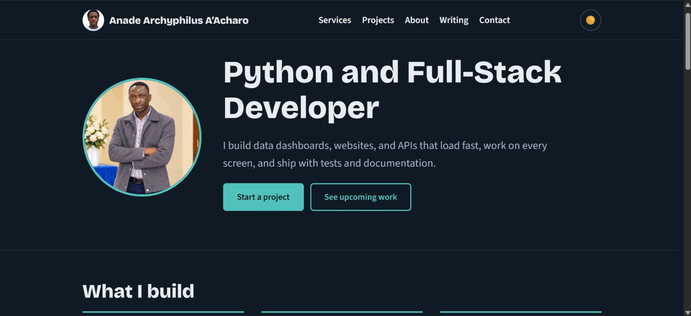
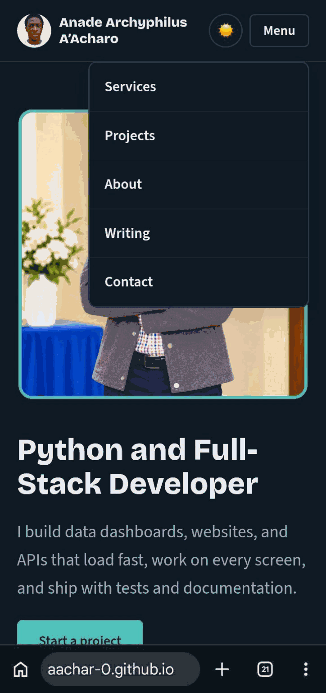

# Anade Archyphilus A’Acharo | Developer Portfolio

> A fast, accessible, search-optimised portfolio for a Python and full-stack developer, built with plain HTML, CSS, and JavaScript. No frameworks, no build step, no trackers.

**Live site:** [aachar-0.github.io](https://aachar-0.github.io/)

---

## Table of contents

- [Overview](#overview)
- [Screenshots](#screenshots)
- [Features](#features)
- [Performance](#performance)
- [Technical decisions](#technical-decisions)
- [Tech stack](#tech-stack)
- [Project structure](#project-structure)
- [Run it locally](#run-it-locally)
- [Deployment](#deployment)
- [Privacy and ethics](#privacy-and-ethics)
- [Portfolio roadmap](#portfolio-roadmap)
- [Contact](#contact)
- [License](#license)

## Overview

This site is the home base for my freelance work in **data dashboards, websites, and APIs**, with scholarly writing and editing support. It links to every project I publish and is designed to be fast on slow mobile connections, usable with a keyboard or screen reader, and easy for search engines to understand.

It deliberately uses no frameworks. Plain HTML, CSS, and JavaScript keep the page light, remove dependency risk, and show the fundamentals that everything else is built on.

## Screenshots

| Desktop (dark) | Mobile (menu open) |
|---|---|
|  |  |

The live site is the best preview: [aachar-0.github.io](https://aachar-0.github.io/).

## Features

**Layout and design**
- Mobile-first responsive layout, tested from small phones to wide desktops
- Sticky header with a dropdown mobile menu that closes on link tap, outside tap, or the Escape key
- Light and dark themes: follows the device setting, with a manual toggle that remembers the visitor's choice
- Photo and layout adapt on phones: large centred portrait with the headline below

**Content**
- Services, upcoming projects with status labels, About, Scholarly writing support, and Contact sections
- Footer with GitHub, LinkedIn, and X links using inline SVG icons that follow the active theme

**Contact form**
- Messages delivered by email through Formspree, with sending, success, and error feedback
- Clear field labels, browser autofill support, and no page reload

**Accessibility**
- Semantic HTML landmarks (`header`, `nav`, `main`, `section`, `footer`)
- Skip-to-content link, visible keyboard focus, and labelled controls
- ARIA state on the menu button (`aria-expanded`) and a live status message on the form
- Respects the `prefers-reduced-motion` setting

**Search engine optimisation**
- Unique title and meta description, canonical URL, and one `h1`
- Open Graph and Twitter cards with a purpose-built 1200×630 share image
- schema.org `Person` structured data (JSON-LD)
- `sitemap.xml` and `robots.txt`, with the sitemap submitted to Google Search Console

## Performance

Google PageSpeed Insights, mobile, tested November 2026:

| Category | Score |
|---|---|
| Performance | 94 to 98 |
| Accessibility | 100 |
| Best Practices | 100 |
| SEO | 100 |

Scores vary slightly between runs. The page ships one small stylesheet, one small script, compressed images with fixed dimensions, and font loading with fallbacks.

## Technical decisions

| Decision | Reason |
|---|---|
| No framework or build step | A single static page does not need one. It keeps load time and maintenance low. |
| CSS custom properties for themes | One set of colour variables drives light, dark, and the manual toggle. |
| Inline SVG icons | No extra network requests, and they inherit the text colour through `currentColor`. |
| `defer` on the script and a tiny inline theme loader in `<head>` | The saved theme applies before first paint, so there is no flash of the wrong colours. |
| Dedicated 1200×630 share image | Social platforms crop to a wide ratio, and a square portrait loses the face. `tools/make_og_image.py` builds a card with the whole photo visible. |
| Formspree for the contact form | GitHub Pages is static, and this delivers messages without running my own server. |
| `try/catch` around `localStorage` | Some browsers and private modes block it, and the page must still work. |

## Tech stack

- **HTML5**: semantic structure, forms, structured data
- **CSS3**: custom properties, flexbox, grid, media queries, `clamp()`, `aspect-ratio`
- **JavaScript (ES6+)**: DOM, events, `fetch`, `async/await`, `localStorage`
- **Python 3 with Pillow**: generates the social share image
- **Git and GitHub Pages**: version control and hosting

## Project structure

```
AAchar-0.github.io
├── index.html              Page content, SEO tags, structured data
├── css/
│   └── style.css           Themes, layout, responsive rules
├── js/
│   └── script.js           Menu, theme toggle, contact form, footer year
├── assets/
│   ├── photo.jpg           Hero portrait
│   ├── logo.jpeg           Header logo
│   └── og-image.jpg        1200x630 social share card
├── tools/
│   └── make_og_image.py    Builds the share card from the portrait
├── docs/
│   └── screenshots/        Images used in this README
├── robots.txt              Crawl rules and sitemap location
├── sitemap.xml             Page list for search engines
├── LICENSE                 MIT
└── README.md
```

## Run it locally

1. Clone the repository:
   ```bash
   git clone https://github.com/AAchar-0/AAchar-0.github.io.git
   cd AAchar-0.github.io
   ```
2. Open the folder in VS Code.
3. Install the **Live Server** extension, right-click `index.html`, and choose **Open with Live Server**.

To rebuild the social share image (requires Python 3):

```bash
pip install pillow
python tools/make_og_image.py
```

The script reads `assets/photo.jpg` and writes `assets/og-image.jpg`. Run it from the project root, because the paths are relative.

## Deployment

The site is deployed with GitHub Pages straight from the `main` branch (Settings → Pages → Deploy from a branch → `main` / root). Pushing to `main` publishes the change within a few minutes.

```bash
git add .
git commit -m "Describe the change"
git push
```

File names are case-sensitive on GitHub Pages, so `photo.jpg` and `Photo.jpg` are different files.

## Privacy and ethics

- The only personal data collected is what a visitor types into the contact form, which is emailed to the site owner by Formspree.
- There are no analytics, advertising, or tracking scripts. The theme choice is stored in the visitor's own browser and never sent anywhere.
- The portrait is the owner's own, used with consent.
- Writing support means editing and improving a client's own work. It does not include writing assignments to be submitted as someone else's.
- All data projects in this portfolio use public datasets with clear licences.

## Portfolio roadmap

This site links to the projects below as each one ships.

| Project | Stack | Status |
|---|---|---|
| E-commerce analytics and forecasting dashboard | Python, SQL, Streamlit | In progress |
| Consent-based face verification | Python, OpenCV | In progress |
| Booking app with AI assistant | JavaScript, Node, SQL | Planned |
| REST API for inventory | Java, Spring Boot, PostgreSQL | Planned |
| Concurrent log analyzer | Java | Planned |
| Small-business website | HTML, CSS, JavaScript | Planned |

## Contact

- Website and contact form: [aachar-0.github.io](https://aachar-0.github.io/#contact)
- LinkedIn: [Anade Archyphilus A’Acharo](https://www.linkedin.com/in/anade-archyphilus-acharo-9b83a5324/)
- GitHub: [@AAchar-0](https://github.com/AAchar-0)
- X: [@a_acharo](https://x.com/a_acharo)

## License

Released under the [MIT License](LICENSE). The portrait and logo images are personal and are not covered by this licence.
